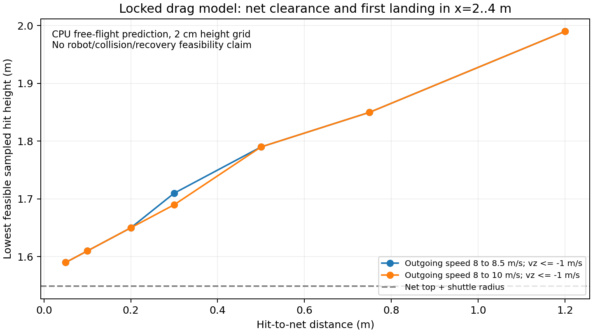

# G07 v3：越网可行域与全身搜索准备

本轮完成了 CPU 计算和代码准备，没有启动新的 GPU 仿真、训练或正式评测。原 G07 最佳策略仍是 `train_high_attack_all01/checkpoint.pt`；历史 400 回合完整成功率仍为 0，不能据此宣称学会扣杀。下一步是实际验证能够越网的全身轨迹，然后采集、学习和独立评估。

## 高度结论更正

撤回提交 `8f57520` 中“1.535 m 保守硬件上界”的结论。随机采样最高 1.253 m 和已搜索到的根部上升约 0.147 m 都是找到的样本值。盒体任意姿态的世界竖直半延伸为 `sum(abs(R[2,:])*half_extents)`；尺寸 0.015×0.22×0.22 m 对应的旋转无关半对角线约 0.15574 m。不能把局部 0.11 m 当成通用世界高度上界。

固定根部 z=0.323 m 的 URDF 数值优化找到球拍中心 z=1.254516 m。限定有效平面内部接触、拍面法向 nx≥0.9、|ny|≤0.1 时，优化找到的球心接触高度为 1.333392 m。二者都不是动态执行证据或全局最优证明。名义初始姿态与原生轨迹的 FK 位置差小于 1 µm；与旧随机探测记录的最大差约 17.4 mm，因此后续必须在新原生 rollout 中核对实际关节、机身姿态和拍面，不能依赖毫米级 CPU 余量宣称成功。

按 URDF 连杆长度、安装偏移与工具几何作三角不等式，得到距 Go2 根部约 1.19751 m 的宽松位置界；它不提供根部动态高度上界，也不证明系统不可行。

## 当前资产含义

`asset_inspection.json` 直接读取现有 USD，未启动 Kit/PhysX/GPU。球拍是 0.09 kg、0.015×0.22×0.22 m 的盒体，中心通过固定关节放在标准 PiPER link6 的 [0.18,0,0] m；质量、惯量、几何和构建配置一致。现有 racket JSON 仍描述旧平面模型/零偏移，不能作为当前工具几何的权威来源。

没有找到实测球拍、握持位置、柄长或安装 CAD 来证明这就是计划中的实体设计。它继续标为参数化假设，本轮没有修改工具、结构、载荷或执行器。不能把当前模型结果当作实机能力界限。

## 耦合飞行计算

`flight_regions.json` 采用锁定二次阻力和重力做 RK4，联合检查前向出球、总速≥8 m/s、vz≤−1 m/s、网体厚度/球半径净空及第一次落地 x∈[2,4]、|y|≤1。计算在首次落地停止，不含地面反弹。下表是搜索网格中找到的最低球心高度（2 cm 高度步长、速度上限 10 m/s），不是严格必要高度界：

| 距网距离 m | 网格内最低可行球心高度 m |
|---|---|
| 1.20 | 1.99 |
| 0.75 | 1.85 |
| 0.50 | 1.79 |
| 0.30 | 1.69 |
| 0.20 | 1.65 |
| 0.10 | 1.61 |
| 0.05 | 1.59 |

搜索种子 `next_search_seed.json`：击球点 [1.4,0,1.65] m，期望出球 [7.5,0,−3] m/s，总速约 8.078 m/s；预测网心净空约 6.01 cm，保守网后缘净空约 4.54 cm，首次落地 [3.961,0,0.025] m。物理一致来球从 [8.18,0,1.15] m 以约 [−5.60689,0,7.34002] m/s 发射，可预测在 1.35 s 到达该点。

这些是机器人尚需通过真实碰撞产生的目标。法向速度的无限质量估算只用于初始化，不是有限质量全身碰撞解，不会写入球的碰撞后速度。



## 新搜索与事件顺序

`quadsmash/physics/smash_events.py` 和 opt-in `OrderedSmashEnv` 使用真实力确认的有效面空中接触、分离后的完整出球向量、有效前向越网和首次落点。先落地再弹过网、绕网侧、仅碰拍边、二次触球及数值漏碰不能计入完整成功。恢复和球的结果都来自同一回合；恢复可与球飞行在时间上重叠。

`scripts/search_g07_whole_body_v3.py` 对所有 18 个关节目标及时间缩放进行联合 CEM 搜索。旧轨迹仅用于初始化，腿部不冻结，动作可覆盖已有真实关节限制；执行器参数和资产不变。候选按真实完整成功、越网及首次落点优先排序，连续飞行预测和接近距离仅作探索辅助。它输出明确标记的演示候选，不是学习策略。

新原生环境和搜索入口已通过语法检查，尚未执行；没有把 CPU 测试当作运行验收。包含历史物理回归和新增时序/几何/预算保护的 85 项 CPU 测试通过，原始 JUnit 见 `cpu_tests.xml`。真正找到可重复有效演示后，仍需采集数据、训练目标与观测条件化策略，并按两个冻结开发面板共至少 400 回合取较差指标评估；本轮没有缩小这些完成要求。

## 资源与下一步

原授权 `g05-g07-20261022` 开始于 2026-10-22 14:08:14 UTC，10 小时截止于 2026-10-23 00:08:14 UTC（北京时间 08:08）。历史两个相关账本键累计约 3.182811 GPU-hours。后续 continuation 键不得重置这一起点或 10 GPU-hour 总额度。已修复调度器继承原截止时间及总账约束，并实际验证过期命令在启动进程之前被拒绝；本轮 GPU 账本与开始时哈希相同。

等待用户明确新的 GPU0 时间窗和 GPU-hours 上限。取得授权后应先对新事件记录与全关节接口做小批量原生运行，再开展能够改变越网可行性的联合搜索；不会再次对旧砸地策略做完整 400 回合复评。

CPU 复现（输出目录需为新目录）：

```bash
/home/autodrive/Isaac/env_isaaclab/bin/python scripts/g07_plan_feasible_strikes.py --output reports/G07/new_cpu_run
/home/autodrive/Isaac/env_isaaclab/bin/python scripts/inspect_g07_asset_cpu.py --output reports/G07/new_cpu_run/asset_inspection.json
/home/autodrive/Isaac/env_isaaclab/bin/python scripts/plot_g07_flight_regions.py --input reports/G07/new_cpu_run/flight_regions.json --output reports/G07/new_cpu_run/flight_regions.png
```

新有效授权入账后的首次原生命令模板（当前不能运行，`NEW_AUTHORIZATION_WINDOW` 必须来自用户的新授权）：

```bash
/home/autodrive/Isaac/env_isaaclab/bin/python scripts/run_gpu_job.py --goal G07 --budget-window NEW_AUTHORIZATION_WINDOW --max-seconds 180 --env-steps-cap 100000 --output reports/G07/ordered_wholebody_smoke01 --require-artifact metrics.json -- /home/autodrive/Isaac/env_isaaclab/bin/python scripts/search_g07_whole_body_v3.py --output reports/G07/ordered_wholebody_smoke01 --launch-config configs/g07_feasible_search_launch_v3.json --num-envs 8 --generations 1 --physics-dt .00025 --headless
```
