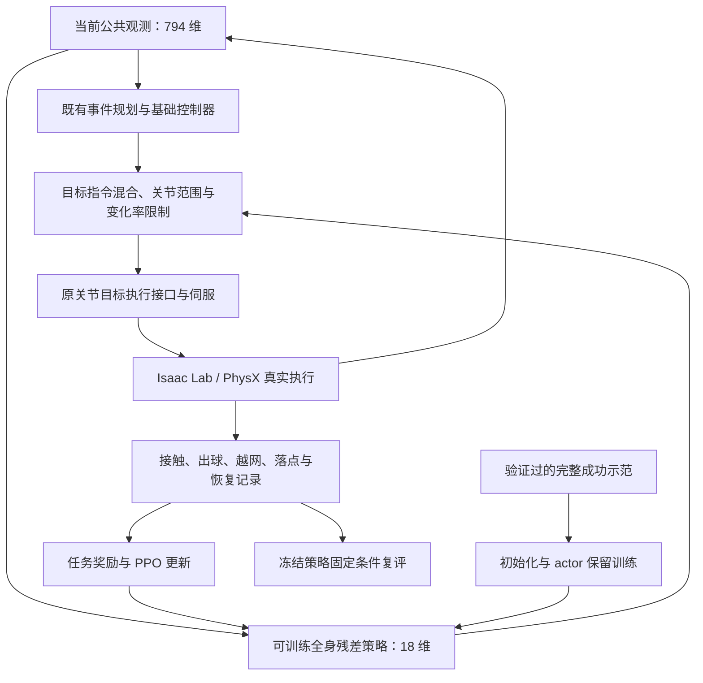

# Go2＋PiPER 腾空扣杀：当前整体技术路线与实验状态

更新时间：2026-10-31 15:36（北京时间）。这是截至该时点的技术快照，训练继续运行，文内运行进度不会自动更新。

**当前主线是：在真实 Isaac Lab / PhysX 耦合仿真中，以已有击球与恢复控制器提供基础动作，再用全身残差 PPO 学习改进；使用真实完整成功回合做初始化和成功示范保留训练，最后冻结策略单独复评。**

已经找到能完成整条任务链的实例，但尚未获得高成功率策略。当前可复现的学习初始化基线为 **11/128 完整成功**，上一轮 16 次更新后为 **7/128**。新的 **5120 环境、48 次更新**训练正在运行，尚无新策略的冻结复评结果。

## 1. 任务是什么，怎样才算成功

机器人为 Go2 四足底盘＋标准 PiPER 六自由度机械臂＋完整球拍和夹具，控制维度为 **12 个腿关节＋6 个机械臂关节**。每个回合从地面实际执行准备、起跳、腾空挥拍、击球、落地和恢复。

当前成功条件必须在**同一回合、同一次合格击球及其后续恢复**中共同满足：

1. 在四足腾空时发生合法拍线触球；拍框、拍杆碰球不能替代合格拍线触球。
2. 实际释放后的球速至少 **5 m/s**，向下速度分量满足 **vz ≤ −1 m/s**。
3. 球实际越网，并首次落入既定目标区。
4. 机器人完成同次飞行对应的落地恢复，连续 **0.8 秒**满足冻结的稳定条件，无相关违规事件。

用户已明确要求速度够用即可，因此 5 m/s 是当前主指标，8 m/s 只保留作历史对照。保留拍速塑形奖励，但不以继续追求更高速度替代完整成功率。

正式可靠性目标仍为：完整成功率至少 50%、空中触球率至少 70%、触球后的条件恢复率至少 85%。正式开发验收要求预定 A/B 面板各 200 回合，按较差面板判断。当前反复使用的 128 例是**开发与训练条件上的对照集，不是未见测试集，也不是正式验收**。

## 2. 场景、物理模型与边界

| 项目 | 当前定义 |
|---|---|
| 坐标 | 局部 x 从己方向对方，z=0 为地面 |
| 球场 | 长 13.4 m，单打宽 5.18 m |
| 球网 | 网面 x=1.5 m，中心高 1.524 m，侧边高 1.55 m |
| 目标区 | x∈[2,4] m、y∈[−1,1] m，即对方场内 2×2 m 区域 |
| 球拍 | 总长 0.675 m，包含夹具、拍柄、拍杆、拍框与拍线碰撞几何 |
| 羽毛球 | 5.2 g 刚体替代模型；没有宣称已标定真实羽毛球空气动力学 |
| 球网模型 | 刚性等效网带；不包含柔性网布动力学 |
| 当前地面 | 64×64 m 仿真地面；不是把球场或目标区放大到该尺寸 |
| 控制周期 | 0.01 s，即 100 Hz |
| 物理步长 | 当前原生输入记录为 0.0000625 s |
| 回合 | 最长 8 s；实际失败可能提前终止 |

机器人、球拍质量和执行器限制保留。球拍是明确标注假设的参数化模型，并非厂家完整 CAD 或实物标定模型；当前结论属于仿真，不等于真机可部署。

并行环境采用已经做过精度与碰撞隔离检查的原点布局，以减小大世界坐标造成的浮点漂移。它不表示多台机器人相互碰撞，也不意味着可直接继承旧布局成绩。此前地面范围和布局修订均须重新做原生物理验证。

## 3. 实际运行的控制与学习架构



**基础控制层。** 当前执行契约为 `shared_target_bias`，保留已有事件参考、起跳/挥拍/恢复控制及两套冻结的源 actor。恢复使用既有站立切换与关节反馈参数。它提供已经物理执行过的行为起点。

**可学习层。** PPO 输出 18 维残差，同时作用于腿和机械臂，而非永久固定腿部只训练挥拍。当前各关节残差尺度为 0.4 rad，经过残差、关节范围和指令变化率限制后进入原执行接口；机械臂目标变化率配置为 10 rad/s。这里的“目标变化率”不等于实际关节速度或拍头速度。

**闭环信息。** 策略读取 794 维公共观测；接触后的探索幅度调整依据已经观测到的事件/阶段，不读取未来成功标签来控制动作。仿真事件真值用于奖励、审计和离线判分，与策略动作输入分开。

**当前不是从零独立控制的纯 RL。** 新残差 actor 自主输出修正，但仍依赖上述基础控制器和冻结源策略。本轮关闭的是“额外教师在线接管动作”分支，不是删除所有基础控制。报告不能把这两个概念混为一谈。

## 4. 奖励和探索如何服务完整成功

当前奖励由以下几部分组成：

- 任务事件：腾空、合法触球、有效攻击、越网、目标落点、触球后恢复和完整成功。
- 连续引导：拍线接近/对齐、落点误差、落地姿态与速度质量、连续稳定进度。
- 保留拍速奖励，当前目标为 5 m/s；出球速度收益在任务阈值附近饱和，降低只追求高速的倾向。
- 违规和代价：机身触地、任务违规等；击球前另有较小的残差偏离代价，帮助保留已有可行前缀。
- 击球后和恢复阶段降低随机探索标准差，当前乘数为 0.15，减少落地阶段随机指令破坏支撑。

完整成功事件权重为 150，触球为 40、恢复为 20，但加权奖励本身不能保证联合成功。最终必须分别核对所有物理条件，不能用高奖励抵消摔倒或落点失败。

“充分利用 GPU”是实验调度目标，不是加入机器人奖励函数的优化目标。

## 5. 已验证的效果：哪些进步成立，哪些不成立

下表均按当前 5 m/s 条件统计完整成功；恢复列是合格空中触球后的条件恢复数量。

| 方法/实验 | 固定回合数 | 合格空中触球 | 合格恢复 | 完整成功 | 解释 |
|---|---:|---:|---:|---:|---|
| 历史带击球后教师辅助的参考 | 128 | 62 | 17 | 14（10.94%） | 可以提供完整实例，远未稳定；含教师辅助 |
| 本轮学习初始化基线 | 128 | 62 | 15 | 11（8.59%） | 无额外教师接管；仍有基础控制器 |
| 上一轮 16 更新 PPO | 128 | 77 | 23 | 7（5.47%） | 触球与恢复增加，完整成功反而下降 |
| 同一 16 更新 actor＋另一组恢复参数实际生效 | 128 | 77 | 0 | 0 | 控制参数试验失败，不能归因成 RL 没学会触球 |
| 显式固定原有效恢复参数后的初始化基线 | 128 | 62 | 15 | 11（8.59%） | 所有 128 例的对应结果与原基线一致 |
| 当前 48 更新＋成功保留训练 | 待完成 | 待复评 | 待复评 | 待复评 | 不能提前声称有效 |

上一轮 PPO 的关键信号不是“触球从 62 增加到 77”，而是：**原来的 11 个完整成功案例全部丢失，新获得 7 个不同案例，成功案例重叠为 0。** 原有成功丢失的类别为：仅恢复失败 5 例、仅球结果失败 2 例、两者同时失败 3 例、失去空中触球 1 例。

这说明现有优化会改变整条动作链，局部指标改善不能保证最终任务改善。它支持开展成功示范保留实验，但尚不足以证明唯一原因就是灾难性遗忘。

上一轮训练过程中曾统计到 605 次完整成功、7378 次空中触球和 1260 次恢复，共 19649 个已结束回合。这些回合来自不断变化的策略和探索噪声，**不能当成某个冻结策略的成功率**。

## 6. 当前主要瓶颈

**第一，落地后的持续支撑仍然薄弱。** 在 11/128 基线中，43 例满足球侧条件，但其中 32 例未完成恢复。不能只解决首次脚触地，还要在后续保持支撑并满足稳定窗口。

**第二，击球与恢复耦合。** 上一轮策略空中触球增至 77 例，恢复增至 23 例，但满足球侧条件的案例从 43 降至 28。挥拍时机、拍面、出球状态和落地状态会同时变化，需要优化整段动作。

**第三，当前教师覆盖率本身不足。** 带辅助参考也只有 14/128 完整成功，不能假设已经有高质量、覆盖全部来球的专家。直接大量复制所有教师回合会把失败恢复一起学进去。

**第四，工程一致性会影响学习结论。** 已经发现并处理过如下问题：

| 问题 | 影响与处理 |
|---|---|
| 离线 actor 已更新，但规范检查点仍是旧权重 | 可能训练了错误初始化。已修正导出/转移，当前原生初始化逐张量验证 |
| 恢复参数只在构造时写入，随后被 reset 覆盖 | 配置声明与实际动作不一致。当前在每次 reset 后重新应用声明参数并检查各环境 |
| 回合没执行完就根据零成功作结论 | 8 秒完整动作被短观察窗口截断。当前按完整回合/完整首批环境统计 |
| 训练统计与冻结评测混用 | 训练中成功不代表最终导出策略成功。当前保留独立冻结复评 |

恢复参数问题需要特别说明：让原先声明的那组参数真正生效后，77 个空中触球仍在，但恢复变为 0。失败分解为 54 例非足部触地、23 例机身高度过低终止；这不是单纯稳定窗口太严。由于同时变动多个参数，尚不能把责任归给某一个增益。

当前采用的处理是：保留正确的 reset 语义，同时显式设置为此前实际有效的参数，并重新执行 128 例确认恢复到 11 次完整成功。

## 7. 正在运行的新实验

**实验假设：从较好的 11 次成功初始化出发，在 PPO 扩展能力时，用实际完整成功示范约束 actor 的退化，争取兼顾新成功与旧成功。**

| 项目 | 当前配置 |
|---|---|
| 设备/并行规模 | GPU0，5120 个原生物理环境 |
| 更新次数 | 48 |
| 每次 rollout | 每环境 128 个控制步，共 655360 步 |
| 总计划交互 | 31457280 个控制环境步 |
| 条件覆盖 | 既有 128 个训练条件的并行实例；不等于 5120 个未见场景 |
| 随机种子 | 882071 |
| actor / critic 网络 | 256→128→64，ELU |
| PPO | 学习率 3e−4，5 epochs，8 minibatches，γ=0.997，λ=0.98 |
| 预热 | 前 7 次更新冻结 actor 权重，训练 critic；正常更新观测归一化统计 |
| 示范来源 | 初始化基线 11 条＋上一轮策略 7 条，共 18 条完整成功回合 |
| 示范规模 | 14400 个实际观测样本，每条完整 8 秒轨迹 |
| 保留训练 | 预热后每次 PPO 更新追加 4 个 actor-only 监督步，batch=1024，学习率 1e−5 |
| 辅助损失 | 原始残差拟合误差＋对本次 PPO 更新后 actor 的局部软约束 |
| 数据采样 | 按回合均衡采样；监督优化器和采样器状态随检查点保存 |
| 后续评估 | 自动冻结最终策略，原条件 128 例，关闭额外教师动作接管 |

监督标签不是把记录的绝对关节目标直接当残差。每个来源的 actor 在真实观测上生成原始 18 维残差标签，再通过实际控制链重放，核对最终下发指令与物理记录一致。当前最大重放误差约 1.64e−5，低于既定 5e−4 容差。

这里需要严谨区分：18 条分别成功的示范来自两个策略，**并不意味着已经存在一个能同时完成这 18 条的策略**。能否合并、保留和扩展能力，正是本轮需要验证的内容。

截至本报告快照，已完成 **1/48 次更新、655360 控制环境步，数值故障 0**。尚无完整结束回合。检查点确认 actor 和 log_std 未改变，critic 已更新，成功保留优化器尚未执行，符合预热设计。归一化统计仍更新，因此“actor 权重冻结”不等于观测到动作的映射完全不变。

## 8. 与“完整动作生成器＋控制辅助”的关系

用户提出的长线方案是：

```text
落点与越网目标反解
  → 多个可行击球事件
  → 联合优化准备、起跳、挥拍、落地与恢复
  → 反馈跟踪 / 局部 MPC
  → Isaac 实际执行与修正
  → 扰动验证及完整示范
  → BC / DAgger / RL
```

这仍是有价值的方向，但**当前不能声称整套生成器已经完成**。现阶段真正投入主训练的是已有事件/基础控制＋全身残差 PPO＋真实成功示范。当前活动配置没有启用新建的全身 MPC 或支撑 QP 来完成每步动作求解。

完整轨迹优化和落地辅助控制应该以“同一原生回合的完整成功率提升”为入口标准。离线优化收敛、控制器单元测试、站立测试或好看的轨迹动画，都不能替代原硬件约束下的完整物理执行。

如果引入新的落地控制器，应从实际执行到达的落地前状态接管，对比非足部触地、根高度、足端支撑、恢复以及最终完整成功。不能从理想姿态瞬移开始，也不能只报告站立稳定而忽略球的结果。

## 9. 下一步怎样决定继续哪条路线

1. **完成本轮 48 更新及固定复评。** 比较完整成功、空中触球、条件恢复、球侧结果，以及逐案例的保留/丢失/新增；奖励曲线仅作为诊断。
2. **若完整成功提高且保留旧成功，继续验证覆盖面。** 在明确划分的开发扰动上测试来球和初态变化，再进入正式面板；不能把反复调参的 128 例称为泛化证据。
3. **若仍丢失已有成功，定位学习偏移发生在哪一段。** 检查 actor、归一化、实际下发指令与碰撞事件，再决定示范权重、采样和探索调整；不在运行中改动实验输入。
4. **若球侧合格仍主要被恢复吞掉，加强控制辅助的配对实验。** 优先解决实际触地后的持续支撑，并要求保留有效击球前缀；完成后重新做整回合评估。
5. **进一步形成局部闭环教师与独立策略。** 在已确认完整成功的附近扩展反馈与扰动覆盖，必要时引入结构化轨迹搜索或全身优化，再采集偏离状态用于 DAgger 类训练。
6. **最终验证独立性。** 需要明确保留哪些预测/伺服部件，逐步减少并最终移除教师动作补全，对冻结学习策略单独评测。当前残差模式不应提前命名为最终独立全身 RL 成果。

现阶段判断：应继续以**已有可行控制作为起点、成功示范帮助学习、较大规模 RL 搜索改进**为主线，同时针对明确的落地失败做控制实验。当前证据不支持只扩大裸 PPO 训练规模，也不支持认为教师已经足够稳定、问题全在 RL。

## 10. 本机可追溯入口

本次仅发布这份文字报告，以下路径用于本机复核，未随报告上传权重、轨迹或视频。部分最新程序尚在本机工作区，不能仅凭此 GitHub 报告完整复现实验。

工作区：`/home/autodrive/LZQW/unitree_smash_contact_recovery`

| 用途 | 相对工作区路径 |
|---|---|
| 当前训练配置 | `configs/g07_shared_target_ground64_success_retention_v1.json` |
| 训练入口 | `scripts/train_shared_target_ground64_success_retention_v1.py` |
| 成功示范保留更新 | `quadsmash/rl/success_retention_v1.py` |
| reset 后恢复参数一致性 | `quadsmash/control/persistent_recovery_assistance_v1.py` |
| 残差示范导出及实际动作核对 | `scripts/export_verified_residual_retention_v1.py` |
| 当前冻结复评入口 | `scripts/evaluate_shared_target_ground64_persistent_recovery_fasttelemetry_v1.py` |
| 当前主指标要求 | `configs/g07_success_priority_speed5_v1.json`、`goals/G07_smash.md` |

核心证据目录：`reports/G07/continuation_full_cohort_20261031/`

- `MATCHED_BASELINE_INTERPRETATION.json`：11→7 及逐案例损益。
- `PERSISTENT_RECOVERY_RESULT.json`：另一组恢复参数实际生效后变为 0。
- `PERSISTENT_REQUESTED_RECOVERY_FAILURES.json`：相关落地失败分解。
- `PERSISTENT_LEGACY_BASELINE_RESULT.json`：显式恢复原有效参数后 128 例结果一致。
- `RESIDUAL_RETENTION_VERIFIED.json`：18 条完整示范与指令重放核对。
- `SUCCESS_RETENTION_NATIVE_INITIALIZATION_CHECK.json`：原生初始 actor 与实际参数验证。
- `SUCCESS_RETENTION_FIRST_UPDATE_CHECK.json`：首更新预热检查。
- `SUCCESS_RETENTION_PLAN.json`、`SUCCESS_RETENTION_STATE.json`：训练及自动复评计划/状态。

原生运行根目录：`/home/autodrive/LZQW/unitree_smash/reports/G07_full_racket_v5/`

- 当前训练：`success_retention18_persistent_legacy_env5120_updates48_01/`
- 自动排队的冻结复评：`success_retention18_persistent_legacy_updates48_frozen128_01/`
- 已验证的显式恢复基线：`recovery_assist_initial_persistent_legacy_frozen128_01/`

关键哈希：

```text
当前训练配置 SHA256
46e855138ba01ea63e8ed1141ddedef018f4188d08cd1d968821599edadd31ac

当前初始化检查点 SHA256
8a6373c7182df080164cec665604367479cd3ef51381178f363eacdae494c9ef

18 条成功示范 manifest SHA256
ab060740d0ba1836871fc4b2ed908c6464c56020343265ed99189453862292fb
```

当前尚未通过 G07 正式验收，G06 依赖及正式证据也不能由这些开发结果代替。已有完整成功实例证明在当前模型中找到了可行动作，但尚未证明稳定性、广泛泛化或最终独立 RL 能力。
