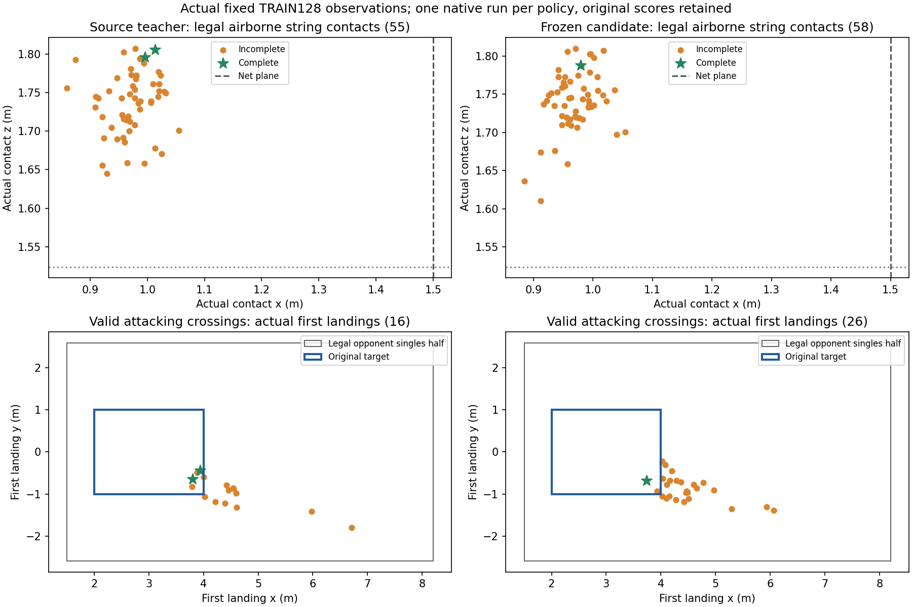

# 第13版固定128例与原教师的逐例比较

第13版原生固定评估已成功结束，128个原TRAIN案例全部从地面执行，零重置扰动、seed724201、原资产/规则/2×2米目标全部保留，数值故障0。当前GPU0已顺序转入第24版；36/48版随后执行，最终来源选择仍按原完整成功、恢复、空中触球顺序比较。

| 原判定链 | 原固定教师 | 第13版 |
|---|---:|---:|
| 合法空中拍线触球 | 55 | 58 |
| 上述触球满足攻击出球 | 19 | 27 |
| 上述攻击有效越网且无违规 | 16 | 26 |
| 上述越网链首次落在原目标 | 4 | 2 |
| 完整成功 | 2 | 1 |

全部空中触球中的合格恢复分别为30/55和32/58。完整成功仍低于原50%门槛，原固定教师的2/128目前高于第13版1/128。原完整案例TRAIN29保留，TRAIN13失去，尚无新增完整案例。一次固定原生运行不能证明跨运行统计显著性。

图上方是全部合法空中拍线实际接触点，下方只展示无违规攻击越网链的真实首次落点。第13版26条链中24条在原目标区外，4条同时不满足合格恢复；2条进目标的链中，TRAIN29完整成功，TRAIN56身体触地且恢复不足。该失效因素存在重叠，不能把24次目标外落点都视为恢复已合格。

原始记录中，第13版TRAIN13首次落点[4.281288,−0.675835]米，超出原目标x上限4米；同时身体触地、稳定窗口仅0.077秒。TRAIN56首次落点[3.928479,−0.929420]米进入原目标，但身体触地、稳定窗口仅0.032秒，不能算完整成功。两个案例均按原恢复条件拒绝，未改写原生标签。

作为已有物理门槛的重叠诊断，恢复合格的有效攻击越网从13次变为21次，全128例身体触地从54次变为45次；这有助于保留后续落点适配的初始化来源，不替代原完整成绩。目标范围仍待用户选择，当前未采用扩大的成功定义。

[128例成对数据表](iter13/PAIRED_CASES.csv)、[逐例变化及判定链](iter13/RESULT.json)、[恢复重叠计数](iter13/RECOVERY_OVERLAP.json)均来自实际完成记录。CSV未观测数值为空，保留全部128例。源数据、策略及实现SHA见PLAN。图已人工式逐项查看，坐标、目标/合法半场、55/58触球和16/26越网链显示一致。

第13版[原始逐回合事件](../body_residual_fresh_iter13_fixed_train128_01/episodes.json)及原所有者导出的[原定义CSV](../body_residual48_after_grid16_queue01/fixed_iter13_TRAIN128.csv)一并保留。完整冷评估姿态、公共输入/动作与实际公共权重将在四版比较结束后统一封包。原正式A/B400案例内容未打开，正式验收未通过。
