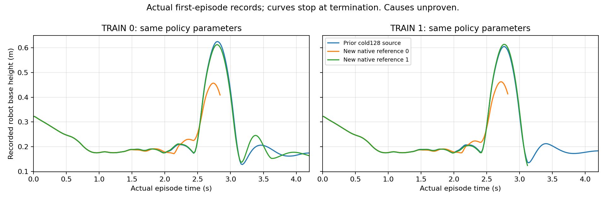

# 第一代实际参考重复与控制指令核对

本分析读取已完成的第一代全部1280个回合，按原独立判定复算10个候选各128例，原完整成功均为0，所有数值故障均为0。它不是原128冷评估或正式A/B成绩。

两条参考的38个参数都与原075第8版逐项相同，根状态13维、18个关节位置和速度与原冷评估初态逐项相同。参考0/1得到5/17次合格空中触球、2/7次条件恢复、0/0次合格攻击。原单策略128冷评估为26空中、19恢复、5攻击。相同参数在这次不同实例位置及批量执行中的实际结果相差较大，不能把并行候选分数的微小差异当作稳定提升；原因尚未建立，不能直接归因于浮点量化。

从两条参考各取固定TRAIN0和1的实际公共输入，共1683个有效100Hz样本，交给原始来源控制器重算，实际GPU指令与CPU原来源指令的最大归一化差异3.9339066e-6，低于登记的5e-4界限。这支持参考仍执行原策略函数；它不承诺批量大小、实例位置或硬件变化时原生轨迹相同，也不证明全部20流的核对完成。正式流水线仍会核对两代各20条实际流。

已记录的794维输入初始最大差异仅3.05e-5或7.63e-6；随后准备阶段的实际状态和指令出现较大差异。附图仅显示固定TRAIN0和1前4.2秒的真实机身高度，首回合终止后不连接自动复位轨迹。原型没有删除失败、改变资产、降低门槛或启动另一GPU作业。

非足端触地标志在两个参考中为109/73例，原冷评估为52例。原body_ground指标合并Go2非足端、PiPER与工具的地面力传感器，不能仅凭此计数判断哪一个部件首先触地；当前数据没有逐部件首次地面力事件，故不宣称已查明失稳部件。

RESULT保留独立逐候选汇总、真实指令回放和输入文件哈希。原分析未单列配置及旧几何顺序，DEPENDENCIES_AND_GROUND_CHECK补充实际配置、相同地面状态及body_names顺序，并验证当前380项原生持有输入仍与启动PLAN一致，未改动或重算原数值结果。第二代与随后固定原128评估继续按原登记计划执行，尚无新冷评估成绩。

