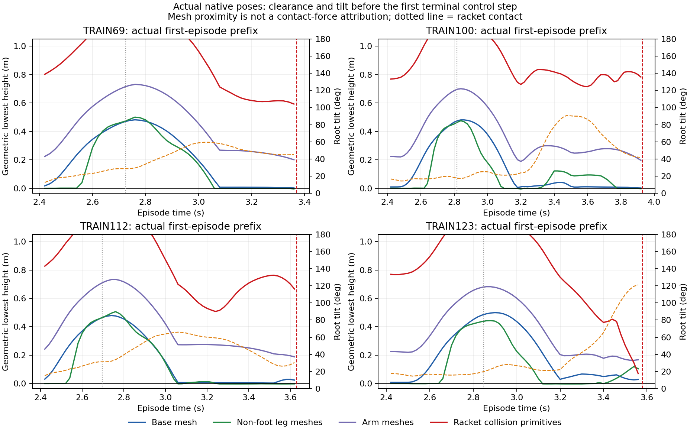

# 非足触地的几何诊断：主要仍需改善全身落地

检查对象是当前全身搜索的**原样候选0**：原128首回合中127例有汇总的非足触地标志。这个标志合并了Go2机身/髋/大腿/小腿、PiPER、安装板及球拍的地面接触力；它没有保存首先产生接触力的具体链接，不能直接等同于“机身先撞地”。本检查未改变原终止、恢复或成功判定。

在这127个触地失败的终止控制步姿态中，导出视觉网格的最近地面部位有124例属于腿段或机身，3例属于球拍。**这是几何最近位置，不是PhysX接触力归属。** Go2头部上下两个链接没有导出视觉网格；它们也不在本次用于归类的原地面传感器链接集合内。球拍则另用原实际碰撞配置的圆柱、胶囊、拍线条及夹具计算支撑高度，没有把无碰撞Handle视觉几何当作地面碰撞体。

| 原样候选0空中触球案例 | 终止控制步 | 终止前末次50Hz采样 | 该采样机身倾角 | 球拍实际几何离地间隙 |
|---|---:|---:|---:|---:|
|TRAIN69|3.37s|3.36s|45.11°|0.593m|
|TRAIN100|3.93s|3.92s|41.68°|0.783m|
|TRAIN112|3.63s|3.62s|30.44°|0.666m|
|TRAIN123|3.58s|3.56s|121.10°|0.070m|

TRAIN123在3.46秒的采样中已倾斜超过90度；3.56秒时机身已翻转约121度，而球拍仍离地7厘米，之后3.58秒的终止控制步球拍近地。因此，此例不支持“球拍先碰地才引起初始翻转”的解释。其他三次空中触球在终止前球拍仍明显离地；把全部失败归因于收拍碰地不符合这些记录。它们仍然需要全身姿态和落地控制适配，现有全身残差课程继续具有针对性。

曲线使用各例**实际首回合有效50Hz姿态**，点线标示实际拍球接触时刻，红色虚线为首次终止的控制步时刻。左轴为几何最低高度，右轴为机身上方向相对竖直的倾角；倾角仅用于描述姿态，不替代原roll/pitch恢复门槛。各例CSV保留原采样，不插值生成新动作或新物理。原完整球拍及全部评分条件保持。

限制：腿、机身和机械臂曲线来自视觉网格，不保证等于其碰撞形状。控制步终止姿态不是精确的首次碰地子步；50Hz之间的接触也不能由图确定。需要逐链接接触力及子步历史才能明确实际首碰部位和完整因果链。目前没有运行该额外原生探针，不能把这个离线诊断称为新的动力学验证。

已在仓库根目录实际执行`CUDA_VISIBLE_DEVICES='' OMP_NUM_THREADS=2 OPENBLAS_NUM_THREADS=2 /home/autodrive/Isaac/env_isaaclab/bin/python reports/G07_full_racket_v4/first_ground_geometry_diagnostic_20261027/analyze.py`，退出0；源数据、代码与配置SHA见`RESULT.json`，482持有输入保持。初次离线运行遇到没有视觉网格的链接，已按实际导出数据处理；最终分析保留缺失几何名称。没有修改或重跑当前GPU作业，也没有上调任何成功或恢复数。

图、4份CSV及[原128终止记录](../gain_body8_sequential_n128_01/episodes_000.json)可直接审阅。复算还需源目录的`geometry.json`、`geometry.npz`及`all_first_episodes_000.npz`，全轮原始几何和50Hz轨迹将在当前八项搜索真实结束后一起归档；这里不声称已经交付当前整轮或完成新的仿真复现。
